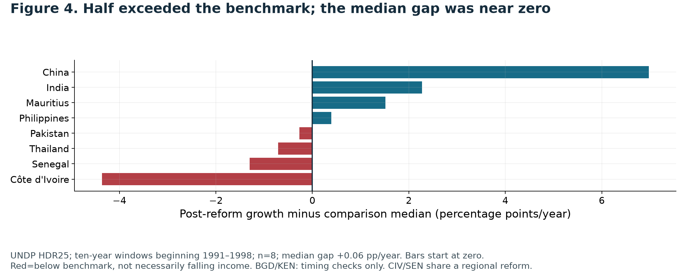

# Tariff Cuts, Uneven Gains

**Income after tariff reforms, with a policy proposal for Nepal**  
Suwarna Pyakurel · Solo participant · Liberty Data Drive 2026

Were large tariff reductions followed by stronger real income growth? This descriptive study combines the supplied Fraser EFW workbook, UNDP HDR25 income data and documented reform dates. It does not identify a causal effect of tariffs.

## Current submission — compact revision, 23 October 2026

The current presentation contains **10 content slides and exactly 4 appendices**, 14 pages total. The closing is on slide 10. Earlier decks and exports are preserved locally as historical versions.

- [Full submission PDF](deck/compact_2026-10-23/LDD2026_SuwarnaPyakurel_Deck.pdf)
- [Speaker notes](deck/compact_2026-10-23/speaker_notes.md)
- [Execution and presentation checks](deck/compact_2026-10-23/FINAL_VALIDATION.json)

Submission filenames: **LDD2026_SuwarnaPyakurel_Deck.pdf** and **LDD2026_SuwarnaPyakurel_Working.ipynb**. The working file is [LDD2026_SuwarnaPyakurel_Working.ipynb](LDD2026_SuwarnaPyakurel_Working.ipynb). Approval, dataset-scope/release acceptance, exact deadline and upload limits remain unconfirmed. No submission or organiser contact has been performed by the assistant.

## Question and main findings

After documented tariff-cutting episodes in India, China, Mauritius, Thailand, the Philippines, Pakistan, Côte d’Ivoire and Senegal during 1991–1998, did real GNI per person grow faster over the following ten years than before reform and than other countries—and what does this suggest for Nepal?

| Finding | Result |
|---|---|
| Countries meeting the numerical tariff screen | 10 |
| Main cases with documented implementation dates | 8 |
| Higher real income per person after ten years | 7 of 8 |
| Growth acceleration with complete five-year prehistory | 3 of 5 |
| Growth above the same-years comparison median | 4 of 8 |
| Median growth gap | +0.06 percentage points/year: near zero and sensitive |

China, India, Mauritius and the Philippines exceeded the benchmark. Pakistan, Thailand, Senegal and Côte d’Ivoire did not. Excluding China gives 3/7 above the benchmark and a median gap of about −0.27 pp/year. Date shifts also change the median’s sign. Higher income, growth acceleration and growth above a benchmark are different findings.



## Data and method

- [Original EFW workbook](data/EFW_original.xlsx): raw mean tariff percentages for selection and tariff histories; chain-linked Area 4 (0–10) for broader institutional context. Raw rates are not described as chain-linked. Coverage extends through 2024.
- [Original UNDP CSV](data/UNDP_original.csv): HDR25, GNI/person in constant 2021 PPP dollars, 1990–2023.
- [Reform-date ledger](research/reform_dates.csv): implementation evidence, dates, precision and exclusions.

Both numerical inputs and the date ledger are embedded in the notebook. Original-file hashes are checked before computation. Country keys, duplicates, joins, missing data and endpoint coverage are validated. No missing values are interpolated.

1. Inspect the two supplied datasets and explore candidate indicators.
2. Screen every eligible matched country for an observed mean tariff decline of at least 20 percentage points in 1995–2005, with both tariff endpoints and some income data.
3. Establish actual implementation years using public policy documents. The screening window differs from reform timing and postdates some early reforms. Date decisions followed exploratory inspection of outcomes; this is not preregistered selection.
4. Retain all ten screened cases in working-file histories. Bangladesh and Kenya lack sufficiently precise comparable tariff-event dates for the main sample; separate timing assumptions are tested. Côte d’Ivoire and Senegal share a regional programme.
5. Align cases at reform year zero, examine −5 to +10 years, and set income at year zero to 100. Common 100 is a calculation, not evidence of an effect. Main event coverage falls within 1990–2008; full 1990–2023 histories remain contextual.
6. Calculate ten-year post-reform compound annual growth and full five-year pre-growth where available. India, China and Mauritius lack full prehistory; shorter histories are not substituted.
7. Compare each case with median valid growth in 148–152 other countries over the same calendar years, excluding all ten screened cases. This benchmark is not a matched or untreated control.
8. Test timing shifts, shorter windows, exclusion of China, related West African cases, balanced membership, threshold coverage and assumed Bangladesh/Kenya dates.

## Six displayed figures

| Figure / slide | Meaning | Exact data |
|---|---|---|
| [1 / 3](figures/compact/Fig1.png) | Ten-country tariff screen | [CSV](outputs/compact/Fig1_data.csv) |
| [2 / 4](figures/compact/Fig2.png) | Reform-aligned income | [CSV](outputs/compact/Fig2_data.csv) |
| [3 / 5](figures/compact/Fig3.png) | Before/after/benchmark growth | [CSV](outputs/compact/Fig3_data.csv) |
| [4 / 6](figures/compact/Fig4.png) | Growth difference from benchmark | [CSV](outputs/compact/Fig4_data.csv) |
| [5 / 7](figures/compact/Fig5.png) | Timing counts and median gaps | [CSV](outputs/compact/Fig5_data.csv) |
| [6 / 8](figures/compact/Fig6.png) | Nepal and regional tariff context | [CSV](outputs/compact/Fig6_data.csv) |

The canonical [chart index](figures/chart_index.csv) maps only these six displayed figures to final PDF pages and notebook cells, counting all cells from 1. The final compact cell generates them. Earlier plots, full histories and extended results remain reproducible in the notebook. Their separate exports and local archives are excluded from Git.

## One Nepal recommendation

**Modification:** amend Schedule 1 of the Customs Tariff Act 2081, as amended, to cap standard non-preferential ad valorem basic duties in HS25–97 at **20% over three budgets**, retaining lower rates. Finance Ministry proposes, Parliament enacts, Customs administers. VAT, excise, specific/mixed duties, prohibitions and preferential arrangements are outside scope.

A lower duty reduces the import-tax wedge. Effects on input costs, prices and choice depend on pass-through and competition. The liberty argument favours wider voluntary exchange and predictable rules, while acknowledging revenue risk, public-service funding and concentrated losses for firms and workers.

Figure 1 documents tariff reductions; Figures 2–5 constrain growth claims; Figure 6 provides Nepal context. **None establishes 20% or three budgets as optimal or estimates Nepal’s fiscal, income, jobs or price effects.** The strongest objection is stated on slide 10. Full scope and archived legal evidence: [policy recommendation](research/policy_recommendation.md).

## Reproduce

Python 3.12 and the recorded dependencies were used. From the repository root:

```bash
python3 -m venv .venv
source .venv/bin/activate
python -m pip install -r requirements.txt
python research/run_nb.py
```

Alternatively open the notebook and Run all. It can restore missing originals from embedded bytes and rejects different existing inputs. To edit source and rebuild:

```bash
python research/build_notebook.py
python research/run_nb.py
```

The readable calculation source is [analysis_steps.py](research/analysis_steps.py). Building the notebook clears outputs; execution regenerates them. There are 30 notebook cells, including 19 code cells. Earlier code calculates the full analysis; the last cell exports the six compact figures.

This repository contains the final presentation PDF and speaker notes. Presentation builders, the template, editable decks, submission bundles and preparation documents remain local. Notebook execution regenerates all analysis exports; only the six final figures and supporting analytical tables are included in Git.

## Research, disclosure and limits

Twenty references are listed in appendix A2–A3 and fully documented in [sources.md](research/sources.md) and the [source register](research/source_register.csv). All source titles link to actual public URLs. Access dates are retained accurately: original research on 16 October, two open fiscal papers on 22 October. The 22 October automated check recorded 15 HTTP successes and five failures/blocks; see the [access report](deck/compact_2026-10-23/source_access_checks.json). A failed check is not a successful current access claim.

Nepal legal evidence remains archived as of 16 October; current legal completeness is unconfirmed. External papers inform fiscal caution, not Nepal effect estimates. Laffer intuition does not establish a revenue peak or self-financing cuts.

OpenAI Codex assisted with research, coding, charts, verification, documentation and presentation preparation. Suwarna Pyakurel remains responsible for reviewing, verifying and explaining the work. Full [AI-use disclosure](research/ai_disclosure.md) appears in A4. The participant confirmed this work was created for this competition and is a solo entry.

No causal effect, optimal tariff, organiser approval, submission or guaranteed score is claimed. Mixed outcomes, exploratory selection, missing prehistory, common regional reforms and unmatched comparisons remain material limitations.
