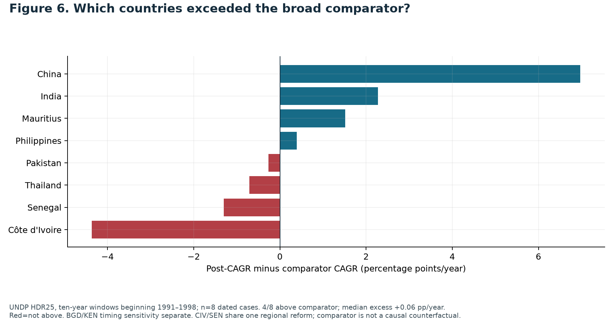

# Tariff Cuts, Uneven Gains

**An analysis of tariff reform and income growth, with lessons for Nepal**  
Suwarna Pyakurel · Solo project · Liberty Data Drive 2026

Did large tariff reductions lead to stronger income growth? This project examines income patterns around documented tariff reforms in eight countries. It combines Fraser Economic Freedom of the World (EFW) data, UNDP income data, and publicly documented reform dates.

The results are mixed: income rose in most countries, but only half grew faster than the comparison benchmark. This is a descriptive study; it does not establish that tariff cuts caused the observed changes.

## Main findings

| Question | Finding |
|---|---|
| How many countries passed the tariff screen? | 10 |
| How many entered the main dated comparison? | 8 |
| How many had higher income ten years after reform? | 7 of 8 |
| How many grew faster than before? | 3 of the 5 with complete five-year pre-reform data |
| How many outperformed the comparison-country median? | 4 of 8 |
| What was the median growth difference from the benchmark? | Approximately +0.06 percentage points per year |

China, India, Mauritius and the Philippines exceeded the benchmark. Pakistan, Thailand, Senegal and Côte d’Ivoire did not. These are different tests: higher income, growth acceleration and growth above the benchmark should not be treated as equivalent.



## Why this topic?

Tariffs provide government revenue and can protect domestic producers, but they can also increase import costs for households and businesses. The topic connects a measurable policy change with income outcomes and a practical policy question for Nepal.

The research question is: **Following documented broad tariff-cutting episodes in India, China, Mauritius, Thailand, the Philippines, Pakistan, Côte d’Ivoire and Senegal during 1991–1998, did real income per person grow faster over the following ten years than before reform and than other countries over the same years?**

## Data

| Input | Role |
|---|---|
| [EFW_original.xlsx](data/EFW_original.xlsx) | Raw mean tariff rates for selection and policy histories; chain-linked Area 4 for broader trade-freedom context |
| [UNDP_original.csv](data/UNDP_original.csv) | HDR 2025 time series; GNI per person in constant 2021 purchasing-power-parity dollars, 1990–2023 |
| [reform_dates.csv](research/reform_dates.csv) | Documented reform years, main-sample status and supporting source information |

The EFW workbook contains observations through 2024. Its earlier observations are generally five-yearly, with annual observations from 2000. The notebook does not interpolate missing years. EFW Area 4 includes institutions beyond tariffs and is not treated as a tariff-only measure.

Public references and access dates are in [sources.md](research/sources.md) and [source_register.csv](research/source_register.csv). Original inputs are preserved and checked against their SHA-256 hashes. Their inclusion does not imply ownership or a new redistribution licence; consult the original publishers for reuse terms.

## How the analysis was carried out

1. **Inspect and validate the inputs.** Check country identifiers, years, duplicates, missing values and coverage. Match countries using three-letter identifiers and validate joins.
2. **Screen for large tariff reductions.** Select countries whose observed mean tariff fell by at least 20 percentage points between 1995 and 2005. Ten countries qualify. This screening period differs from the documented reform years.
3. **Check actual reform dates.** Use public legislation, budgets and institutional reports. Eight countries have sufficiently clear dates for the main definition. Bangladesh and Kenya remain in screening figures and separate timing checks. This was exploratory analysis, not a preregistered study; some outcomes had been inspected before date-quality decisions were finalised.
4. **Examine full income histories.** Plot 1990–2023 to identify starting differences and existing trends. Later years are context; the main event comparisons fall within 1990–2008.
5. **Align countries around reform.** Define event time as calendar year minus reform year, covering up to five years before and ten years after. Set income to 100 in the reform year to compare proportional changes.
6. **Compare growth rates.** Calculate compound annual growth over ten post-reform years and, where available, five full pre-reform years. Only five countries have the full pre-period. Shorter histories are not substituted for it.
7. **Construct a calendar-matched benchmark.** For each case, calculate median growth among other countries with valid income endpoints over the same years, excluding all ten screened countries. This includes 148–152 countries, depending on the window. It is a broad benchmark, not a matched or untreated control group.
8. **Check sensitivity.** Shift reform dates by up to two years, use shorter post-periods, exclude China, check the related West African cases, compare a fixed-member event sample, and test alternative timing assumptions for Bangladesh and Kenya. Threshold checks report missing reform-date coverage explicitly.

Every figure is generated by code and has a corresponding CSV export. No chart values are entered manually.

## Figures and their interpretation

| Figure | What it shows | Exact chart data |
|---|---|---|
| [1](figures/Fig1.png) | Tariff histories of all ten screened countries | [CSV](outputs/Fig1_data.csv) |
| [2](figures/Fig2.png) | Broader chain-linked trade-freedom context | [CSV](outputs/Fig2_data.csv) |
| [3](figures/Fig3.png) | Full income histories; country panels have different labelled scales | [CSV](outputs/Fig3_data.csv) |
| [4](figures/Fig4.png) | Reform-aligned income indices, with changing-member and fixed-member medians | [CSV](outputs/Fig4_data.csv) |
| [5](figures/Fig5.png) | Growth before reform, after reform and in comparison countries | [CSV](outputs/Fig5_data.csv) |
| [6](figures/Fig6.png) | Each country’s growth difference from its benchmark | [CSV](outputs/Fig6_data.csv) |
| [7](figures/Fig7.png) | Sensitivity to shifting reform dates, with valid sample counts | [CSV](outputs/Fig7_data.csv) |
| [8](figures/Fig8.png) | Nepal’s historical average tariff alongside regional peers | [CSV](outputs/Fig8_data.csv) |

The [chart index](figures/chart_index.csv) identifies notebook cells and exports. Its slide numbers refer to the original presentation and are not required to reproduce the analysis.

## One proposal for Nepal

**Modification:** amend Schedule 1 of the Customs Tariff Act, 2081 (2024), as amended, to phase in a **20% cap on standard non-preferential ad valorem basic customs duties for HS Chapters 25–97**, retaining existing lower rates, over three budgets.

The Finance Ministry would propose the change, Parliament would enact it, and Customs would administer it. Lower duties could reduce affected import costs and widen choice, depending on pass-through to buyers. The strongest objection is revenue loss and concentrated adjustment costs for domestic firms and workers. Phasing changes the timing of those costs; it does not eliminate them.

The cap and timetable are proposed design choices, not estimated optima. Figure 8 shows historical averages, not current maximum duties or a fiscal-impact estimate. Full scope and legal-source references are in the [policy recommendation](research/policy_recommendation.md). Legal research cutoff: 16 October 2026.

## Reproduce the analysis

Python 3.12 was used for the recorded verification. From the repository root:

```bash
python3 -m venv .venv
source .venv/bin/activate
python -m pip install -r requirements.txt
python research/run_nb.py
```

Alternatively, open [analysis.ipynb](analysis.ipynb) in a Jupyter environment and run all cells from the repository root. The notebook embeds compressed originals and can restore missing inputs; an existing input with a different hash raises an error.

The readable calculation source is [analysis_steps.py](research/analysis_steps.py). After changing that source or the reform-date ledger, rebuild and execute the notebook:

```bash
python research/build_notebook.py
python research/run_nb.py
```

Rebuilding clears notebook outputs before execution. Execution regenerates figures and result tables. [requirements-lock.txt](requirements-lock.txt) records the fuller dependency environment used for the earlier verification.

## Repository contents

```text
README.md                 Research question, workflow, findings and limitations
analysis.ipynb            Executable analysis with embedded original inputs
requirements*.txt         Dependencies and recorded environment
data/                     Two original datasets
figures/                  Eight figures in PNG/PDF and chart index
outputs/                  Chart data, results, coverage and sensitivity tables
research/                 Core scripts, reform dates, citations and disclosure
```

Draft presentations, submission bundles, downloaded reference archives, caches and local environments are excluded from the current tracked tree. No local research files are deleted by this cleanup.

## Limitations and interpretation

- The study is descriptive and cannot isolate the effect of tariffs from other reforms or shocks.
- There are only eight dated cases, and Côte d’Ivoire and Senegal share a regional reform programme.
- India, China and Mauritius lack the complete five-year pre-reform income history.
- Sensitivity checks change some results; the small median advantage is not a robust causal growth estimate.
- Average income does not measure distribution or every dimension of well-being.
- Nepal’s fiscal, employment, price and affected-product impacts are not estimated.
- Computational checks do not establish organiser acceptance of dataset scope, release or declaration status.

## Acknowledgement of assistance

OpenAI Codex assisted with code, research, verification, figures, documentation and presentation preparation. Responsibility for reviewing and explaining the work remains with the participant. See the [AI-use disclosure](research/ai_disclosure.md).
